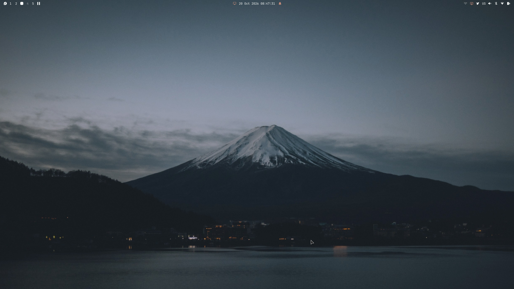
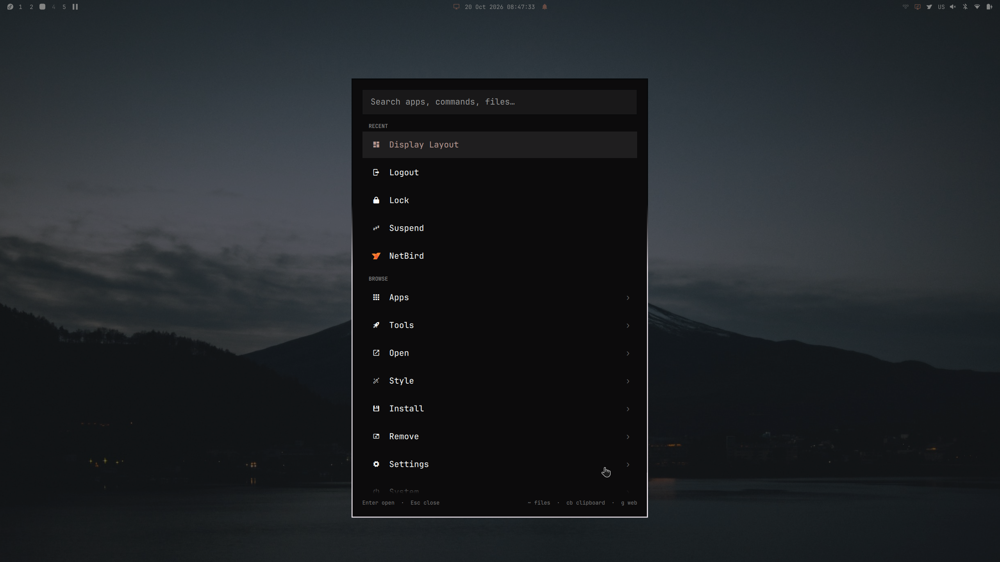
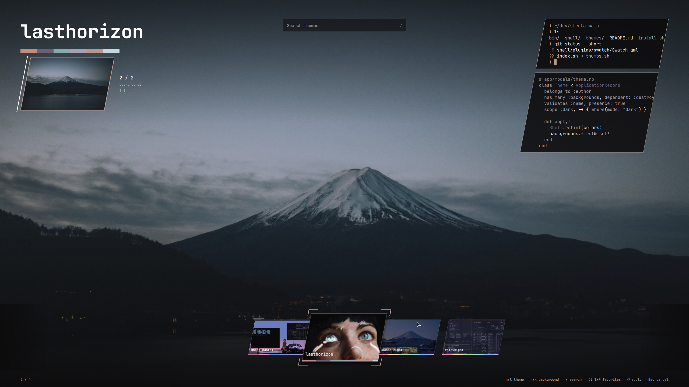

# Strata RPM repository

This is the source and packaging repository for the Fedora-based Strata
desktop. GitHub release builds produce the RPMs and static DNF repository
hosted on Pages. Generated RPMs and metadata are not stored in Git. Fedora
supplies normal desktop dependencies, and Quickshell comes from its COPR.

## Screenshots

The Strata desktop and status bar.



The menu brings applications, tools and settings together.



Preview themes and choose a background in the full-screen theme picker.



## Install on a fresh Fedora 44 system

After this repository is published with GitHub Pages, run:

```bash
curl -fsSL https://name-is-hai.github.io/strata/bin/strata-install-desktop | \
  sudo bash -s -- --enable-greetd
```

Then, as the desktop user:

```bash
strata-apply-config
sudo reboot
```

The installer uses `install_weak_deps=False`, so Fedora does not add optional
Node/npm documentation solely because Neovim is installed.

Fresh configurations start with the Lawson Night theme and its
`wallhaven-1k6ljv.jpg` wallpaper. Existing theme and wallpaper selections are
preserved during updates. The shipped selection is defined in
[`defaults/theme.json`](defaults/theme.json).

## Browser

Chromium is preinstalled. Install any other browser you prefer and make it the
system default from that browser's settings. Strata's browser shortcuts follow
the system default automatically. You can also select an installed desktop entry
with `strata-default-browser org.example.Browser.desktop`.

## Strata update notifications

Strata checks its published DNF repository at startup and every six hours. A
notification and bar icon appear when newer installed Strata packages are
available. Click the icon or select **System → Update Strata** to review the
transaction in a terminal. DNF asks before installing anything.

```bash
strata-update --check  # Check now without installing
strata-update          # Review and install available Strata package updates
```

To publish an update, bump only changed RPMs with `strata-package-version`,
then set the independent release version with `strata-release-version` and
push its matching tag, such as `v1.1.2`. GitHub builds changed targets, reuses verified unchanged
RPMs from the previous release, and verifies the complete repository
and creates a draft release. Test it, then publish the draft to deploy its DNF
repository to Pages. Installed machines then detect the newer RPM versions.
See [Releasing Strata](docs/releasing.md) for the complete process and the
local build instructions.

The checker uses Bash, RPM, DNF, jq, flock and a user cache. An offline check
retains the last result, and each set of available versions is notified once.
Existing custom bars can add the icon with
`strata-bar put strata.system-update --after strata.menu`; new installations
include it by default. Disable the **Strata updates** plugin to stop checks.
Run `scripts/tests/update-check.sh` to test with fake package commands.

## Diagnostics

Run `strata doctor` to check the installed desktop without changing settings.
From this checkout, use `bin/strata doctor`. Session checks work best in a
desktop terminal; unavailable session context is reported as skipped.
